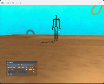
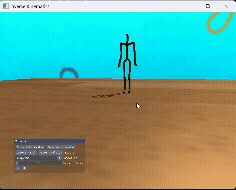

# Forward & Inverse Kinematics for Motion-Capture Skeletons

A C++ implementation of **forward kinematics (FK)** and **Jacobian-based inverse kinematics (IK)** for articulated characters driven by Acclaim motion-capture data (ASF/AMC, e.g. the [CMU Motion Capture Database](http://mocap.cs.cmu.edu/)).

Built for *Computer Animation and Special Effects* (NYCU, Spring 2024). The course provided the rendering and UI framework. This repo focuses on the kinematics solver I implemented in `src/simulation/kinematics.cpp`.

| Forward Kinematics | Inverse Kinematics |
|---|---|
|  |  |

---

## Features

- **Forward kinematics:** converts per-joint Euler angles from AMC files into global bone positions and orientations every frame.
- **Inverse kinematics:** drag a target and the skeleton reaches it. Multiple limb chains are solved one after another.
- **Truncated-SVD pseudo-inverse:** dropping tiny singular values keeps the solver stable near singular poses.
- **Joint limits:** each updated angle is clamped to the bone's DoF range from the ASF file, so poses stay anatomically plausible.
- **Root compensation:** the root translation is adjusted so the chain base stays fixed while the limbs move.
- **Reachability check:** if a target can't be reached within tolerance, the solver reverts to the original posture instead of leaving the arm flailing.

---

## Technical Overview

### Forward Kinematics

The skeleton is a tree rooted at the pelvis. I traverse it breadth-first and compute each bone's global transform from its parent's:

$$
R_i = R_{\text{parent}(i)} \cdot R^{\text{asf}}_{\text{parent}\to i} \cdot R^{\text{amc}}_i
$$

$$
p_i^{\text{start}} = p_{\text{parent}(i)}^{\text{end}}, \qquad
p_i^{\text{end}} = p_i^{\text{start}} + R_i \, \hat{d}_i \, \ell_i
$$

- $R^{\text{asf}}$: the fixed local-axis offset between parent and child, from the ASF skeleton file
- $R^{\text{amc}}_i$: the per-frame joint rotation from AMC Euler angles, applied in ZYX order
- $\hat{d}_i, \ell_i$: the bone's direction and length

The root's position and orientation come directly from the AMC root translation and rotation.

### Inverse Kinematics (Inverse-Jacobian Method)

For each chain, the end effector $e$ is driven toward the target $t$ iteratively.

**1. Build the Jacobian.** Each rotational DoF of joint $i$ contributes one column. That column is the joint's global rotation axis crossed with the arm vector from the joint to the end effector:

$$
J_{\cdot,k} = \hat{a}_k \times (e - p_i)
$$

Only the DoFs the bone actually has (`rx`, `ry`, `rz`) get columns.

**2. Solve for the angle update** with the Moore–Penrose pseudo-inverse via SVD:

$$
J = U \Sigma V^\top, \qquad
J^{+} = V \Sigma^{+} U^\top, \qquad
\Delta\theta = \alpha \, J^{+} (t - e)
$$

Singular values below $10^{-3}$ are zeroed in $\Sigma^{+}$, so near-singular configurations don't produce huge, unstable joint updates.

**3. Update and constrain.** I convert $\Delta\theta$ to degrees, add it to the current Euler angles, clamp each angle to its `[min, max]` limit, and re-run FK.

**4. Repeat** until $\lVert t - e \rVert < \varepsilon$ or the iteration limit is reached.

| Parameter | Value | Effect |
|---|---|---|
| Step size $\alpha$ | 0.1 | Smaller is smoother but slower to converge. Larger can overshoot or oscillate. |
| Tolerance $\varepsilon$ | ~0.1 | Smaller is more precise but may fail to converge under joint limits. |
| Max iterations | 1000 | Upper bound per chain per solve. |

---

## Tech Stack

- **C++17**
- **OpenGL** (via **glad** + **GLFW**) for rendering
- **Eigen** for linear algebra (`JacobiSVD`, affine transforms)
- **Dear ImGui** for the UI
- Acclaim ASF/AMC motion-capture format

---

## Project Structure

```
├── assets/                       # ASF/AMC motion data, shaders
├── extern/                       # third-party libraries (Eigen, GLFW, glad, ImGui)
├── include/                      # headers
└── src/
    ├── simulation/kinematics.cpp # FK + IK solver (my implementation)
    ├── acclaim/                  # ASF/AMC parsing, Bone & Posture structs (course framework)
    └── util/                     # rotation helpers (course framework)
```

---

## Build & Run

### Windows (Visual Studio)

1. Open `InverseKinematics.sln` in Visual Studio 2017 or later.
2. Set the configuration to **Release** / **x64**. Debug builds work but run much slower.
3. Build. The executable will be in `./bin`.

### Other platforms (CMake)

Requires [CMake](https://cmake.org) ≥ 3.14 and a C++ compiler (e.g. GCC). Tested on Ubuntu 20.10 with GCC 10.2.0.

```bash
cmake -S . -B build
cmake --build build --config Release --parallel 8
```

The executable will be in `./bin`.

On Linux you also need the windowing dependencies for GLFW. Usually that's `xorg-dev` for X11, or `libwayland-dev wayland-protocols extra-cmake-modules libxkbcommon-dev` for Wayland.

### Usage

- **Forward Kinematic** mode: pick an `.amc` clip from the *Animation* dropdown, then play, pause, stop, or step through frames. You can also scrub with the *Current Frame* slider.
- **Inverse Kinematic** mode: drag the target spheres, and the hands and feet follow them.
- **Camera Panel**: adjust the view.
